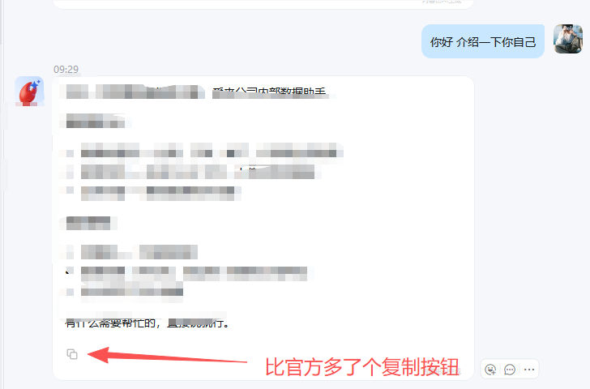

<div align="center">
  
  <h1>dingtalk-openclaw-connector（社区维护版）</h1>
  <p>基于官方 <strong>v0.8.20</strong> 的社区维护版本，由社区持续跟进修复官方无暇处理的 Bug。<br/>
  功能与官方完全一致，拥有最快的修复速度，及时合并官方pr和个人发现的bug和社区急需的 Bug。</p>

  <p>
    <a href="https://www.npmjs.com/package/@dingtalk-real-ai/dingtalk-connector"></a>
    <a href="https://www.npmjs.com/package/@dingtalk-real-ai/dingtalk-connector"></a>
    <a href="https://github.com/jeikl/dingtalk-openclaw-connector-fix-Community/blob/main/LICENSE"></a>
  </p>

  <p>
    <a href="README.en.md">🇺🇸 English</a> •
    <a href="CHANGELOG.md">更新日志</a> •
    <a href="https://openclaw.ai/">OpenClaw 官网</a>
  </p>
</div>

---

## 按用户／群隔离记忆与自学习

此功能按可信钉钉身份隔离记忆和学习成果，不接管 OpenClaw 沙箱、挂载及普通工具策略。安装不会自动启用或改宿主配置。管理员使用显式 `scope check` / `scope setup`；默认只预览，涉及 Gateway 全局原生记忆的变更需单独接受。

完整功能分工、逐项配置影响、旧数据处理、应用与 reload、沙箱及附件边界：[启用与维护说明](docs/scoped-setup.md)。

可选 OpenClaw 工具 `dingtalk_dws` 把真实发言人绑定到**官方 `dws` CLI** 执行，`dingtalk_send_file` 从当前会话工作区发送附件；两者可独立于 `memoryScope` 启用。需配置 `runtimeTools` 和宿主工具权限，DWS 另需本人授权。见[当前 WSL 配置](docs/scoped-runtime-wsl.md)。

固定 OpenClaw main 的独立 scoped Workshop 插件已完成本轮 WSL 双人／群聊验收：[架构与配置边界](docs/scoped-native-workshop.md)。当前 WSL 运行版本和未合入的宿主补丁见配置文档。

交付状态见[双人／双群最终验收报告](docs/scoped-live-e2e-2026-11-04.md)；脚本权限、公共挂载、附件和DWS边界见[执行隔离部署方案](docs/scoped-execution-isolation.md)。scoped 工具隔离不能替代宿主文件系统隔离。


## 🔧 最近更新

按 scope 的自学习能力见[学习边界](docs/scoped-learning.md)：Connector 提供可信范围与存储，独立 Workshop 插件负责工具和复盘；自动复盘默认关闭，显式启用后复用 OpenClaw main 的原生调度与 fork。

| 日期 | 标识 | 更新内容 |
|------|------|---------|
| 2026-10-31 | 📝 | **可编辑钉钉规则（agent-guidance）**：可选增强，安装或升级 connector 不自动启用；显式运行 `guidance setup` 提供规则、配置官方插件并 reload。已有文件默认跳过，支持 `--overwrite-rules` 替换模板；详见 [配置与维护](docs/agent-guidance.md) |
| 2026-10-14 | 📝 | **修复偶发无法换行**：钉钉卡片上有时换行不生效，多行会挤成一行 |
| 2026-10-14 | 🖼️ | **OpenClaw 出站图片**：正文 `` 进卡；独立 `MEDIA:` / `mediaUrl` 等卡片/正文发出后再 `sendMedia`；Agent 写法见 `dingtalk-channel-rules` |
| 2026-10-13 | 📣 | **群聊回复 @ 提问者（at-sender）**：群里 @ 机器人时，回复会 @ 发送人并通知；详见 [at-sender](#-群聊回复--提问者at-sender) |
| 2026-10-12 | 🧭 | **AI Card 执行过程可视化（card-exec-preview）**：opt-in 投影工具/计划/推理；详见 [执行过程可视化](#-ai-card-执行过程可视化card-exec-preview) |
| 2026-10-12 | 👍 | **AI Card 赞踩反馈（card-feedback）**：自定义模板按钮回调写入独立 JSONL；详见 [赞踩反馈](#-ai-card-赞踩反馈card-feedback) |
| 2026-10-09 | 👋 | **企业事件订阅监听（org-events）**：在现有 Stream 上按配置监听企业事件，默认关闭。已提供「企业增加员工」新人指引。详见 [org-events](#企业事件订阅监听org-events) |
| 2026-06-09 | 📁 | **专题 issue 统一至 `memory/*-issue.md`**：`dingtalk-issue` / `musa-stack-issue` / `openclaw-issue`；Agent 禁止堆叠根 MEMORY |
| 2026-06-09 | 🧠 | **memory-scope 架构优化（fix13–15）**：双层 MEMORY 注入、规则 sync、prompt 仅路径、移除 tool-guard；详见 [memory-scope](#-按用户群聊隔离长期记忆memory-scope) |
| 2026-06-08 | 🛡️ | **OpenClaw edit 参数校验 workaround（`edit-empty-oldtext`）**：dist patch 修复空 `oldText` 误报；见 `openclaw-patch/2026.5.7/edit-empty-oldtext/` |
| 2026-06-03 | 🔒 | **按用户/群聊隔离长期记忆（memory-scope）Phase 1**：钉钉多人共用一个 bot 时的 scope 目录与 session 解析；详见下方 [memory-scope](#-按用户群聊隔离长期记忆memory-scope) |
| 2026-05-14 | ✨ | Markdown 图片发送支持直链和本地路径，无需下载到本地，请参考下列提示词|
| 2026-05-11 | 🔧 | Agent 多轮循环完成后，中间过程消息重复发送到钉钉对话，造成刷屏和 AI Card 倒放重渲染 |
| 2026-05-11 | 🐛 | OpenClaw 4.29+ 版本导致钉钉插件失效，群聊 @Agent 回复显示"✅ 任务执行完成（无文本输出）" |
| 2026-05-08 | 🌐 | 未注册的 Pong 监听器导致的 WebSocket 幻影重连，来源于 [PR #566](https://github.com/DingTalk-Real-AI/dingtalk-openclaw-connector/pull/566)（[Majorshi](https://github.com/Majorshi) 提交） |

完整更新日志：[FIXES.md](FIXES.md)（[🇺🇸 English](FIXES.en.md)）

---

## ✨ 增强功能

- 📝 **可编辑 DWS 场景规则（可选）**：安装或升级 connector 不自动启用；管理员显式运行 `guidance setup` 后提供规则、配置官方 `agent-guidance` 并 reload。已有文件默认跳过，`--overwrite-rules` 显式替换模板。目录新增 Markdown 无须改代码。见 [配置与维护](docs/agent-guidance.md)。

- 🔧 OpenClaw 出站图片经 connector 发出。Agent 写法在 bundled skill `dingtalk-channel-rules`（正文 `` 进卡；独立 `MEDIA:` 走 `sendMedia`；无前缀裸路径不转图）。

- 🎨 支持自定义 AI Card 模板，可使用本人预制的卡片（含内容复制按钮），不填则使用官方默认卡片。
- 📣 **群聊回复 @ 提问者（at-sender）**：群聊被动回复时 @ 发送人并通知（见下方专节）。
- 👍 **赞踩反馈（card-feedback）**：卡片按钮回调写入独立 JSONL（见下方专节）。
- 🧭 **执行过程可视化（card-exec-preview）**：可选投影工具/计划/推理到过程区（见下方专节）。

**单机器人：**

```json
"channels": {
  "dingtalk-connector": {
    "enabled": true,
    "clientId": "你的clientId",
    "clientSecret": "你的clientSecret",
    "cardTemplateId": "616459cb-a388-4001-9b65-fbb2665ff94c.schema",
    "cardContentVar": "content",
    "cardProcessVar": "process",
    "cardReasoningVar": "reasoning",
    "cardLikeActionId": "ai_res_like",
    "cardDislikeActionId": "ai_res_dislike",
    "cardFeedbackStatusKey": "like"
  }
}
```

**多机器人（多 Agent）：** 每个账号可绑定不同机器人

```json
"channels": {
  "dingtalk-connector": {
    "enabled": true,
    "accounts": {
      "main-bot": {
        "enabled": true,
        "name": "工作流机器人",
        "clientId": "你的clientId",
        "clientSecret": "你的clientSecret",
        "cardTemplateId": "f9b75aac-713c-40e8-a17f-e236d7b5422b.schema",
        "cardContentVar": "content"
      },
      "another-bot": {
        "enabled": true,
        "name": "另一个机器人",
        "clientId": "另一个clientId",
        "clientSecret": "另一个clientSecret",
        "cardTemplateId": "f9b75aac-713c-40e8-a17f-e236d7b5422b.schema",
        "cardContentVar": "content"
      }
    }
  }
}
```

| 参数 | 说明 |
|------|------|
| `clientId` / `clientSecret` | 单机器人模式直接填在顶层 |
| `accounts` | 多机器人模式，key 为账号标识名（可任意命名） |
| `accounts.*.enabled` | 是否启用该账号 |
| `accounts.*.name` | 账号显示名称（仅用于标识） |
| `accounts.*.clientId` | 钉钉应用 ClientId |
| `accounts.*.clientSecret` | 钉钉应用 ClientSecret |
| `cardTemplateId` | AI Card 模板 ID，不填则使用官方默认模板 |
| `cardContentVar` | 最终回复内容变量名，不填默认 `msgContent`（**唯一**流式正文变量） |
| `cardProcessVar` | 可选：公开工具类别与状态；不展示命令参数 |
| `cardReasoningVar` | 模板字段名保留，内容改为公开工具状态计数；不输出内部推理 |
| `cardToolVar` | 未配置 `cardProcessVar` 时用于公开工具状态；不再写原始工具输出 |
| `cardLikeActionId` | 赞按钮 `actionId`，默认 `ai_res_like` |
| `cardDislikeActionId` | 踩按钮 `actionId`，默认 `ai_res_dislike` |
| `cardFeedbackStatusKey` | 完成态写入的赞踩状态字段，默认 `like`（`0`/`1`/`-1`） |

> 卡片模板需在[钉钉开放平台](https://open.dingtalk.com/)创建，并添加对应的变量字段。正文只走 `cardContentVar`；过程/推理只能经独立变量更新，**不会**回落到流式正文键。

**效果预览：**



### 📣 群聊回复 @ 提问者（at-sender）

群里有人 @ 机器人时，回复会 @ 那个人（蓝色 @ + 钉钉通知）。用入站已有的 `senderStaffId` / `senderNick`，接到原有群聊回复出口，无新配置项。

| 项 | 说明 |
|------|------|
| 开关 | 默认开启；单聊不 @ |
| AI Card | 投放 `imGroupOpenDeliverModel.atUserIds`（通知）；创建时 `cardAtUserIds` + 正文 `@昵称`（卡片内蓝 @）。排队 ACK 与正式回复是同一张卡 |
| 降级 | `sessionWebhook` 的 text/markdown 同样带 `at.atUserIds`，正文附 `@userid` |
| 前提 | 机器人已发布上线（入站才有 `senderStaffId`）；不用加密 `senderId` 去 @ |

### 👍 AI Card 赞踩反馈（card-feedback）

在现有 Stream 上监听卡片回调（`/v1.0/card/instances/callback`），把本轮问答快照与赞/踩追加到**独立 JSONL**（按 `cardId` / `outTrackId` 关联），供旁路分析。**不修改** OpenClaw SQLite / `sessions.json` / transcript。

落盘路径：`$OPENCLAW_STATE_DIR/dingtalk-card-feedback.jsonl`（未设时退回 `$OPENCLAW_HOME/.openclaw` 或 `~/.openclaw`）。文件含两类记录：

- `answer`：卡片结束时写入，含本次 `userPrompt` / 实际展示的 `assistantText` / `status`（`completed` | `failed` | `interrupted`）
- `feedback`：每次赞/踩回调追加；`eventId` 识别重投，同一用户改评保留历史（分析时按 `eventId` 去重、按「卡片＋用户」取最新）

| 项 | 说明 |
|------|------|
| 开关 | 使用带赞踩按钮的自定义模板即可；完成态会写入 `cardFeedbackStatusKey=0` 以便灰钮显示 |
| 模板 | 按钮 `actionId` 需与 `cardLikeActionId` / `cardDislikeActionId` 一致；显示条件绑 `like`（或你配置的 status key） |
| 关联 | 出卡时可选登记短时 `cardId → session` enrichment；回调缺失缓存仍落盘反馈 |
| 落盘 | 仅 `dingtalk-card-feedback.jsonl`；优先本地追加再 ACK（ACK 只表示收到回调） |
| 非侵入 | 不另开 Stream；未配自定义赞踩模板时行为与原先一致 |

### 🧭 AI Card 执行过程可视化（card-exec-preview）

使用 Host 的公开工具、工作项与审批事件，把固定工具类别和真实状态投影到卡片过程区。正文仍只写 `cardContentVar`，不展示命令参数、原始工具输出、任意工具名或内部推理。`cardReasoningVar` 保留已有模板字段名，但现在只写公开状态计数。

| 项 | 说明 |
|---|---|
| 开关 | `cardProcessVar`、`cardToolVar` 或 `cardReasoningVar` 非空，且启用流式 AI Card；process 优先于 tool |
| 身份 | 按 Host 的 toolCallId/itemId 关联同一工具，无法关联的无 ID 事件只显示类别级运行状态 |
| 结果 | 明确成功才标完成；无结果的 end 或回合结束标“已结束，结果未确认”；审批响应不代表操作已执行 |
| 终态 | 迟到 running 不覆盖终态；未收口前收到明确结果，可补充先前未知的 end；取消/失败分别显示 |
| 刷新 | 共用 per-card 写链；节流时保留最新快照并定时刷新，最终状态先于卡片关闭完成提交 |
| 变量 | 过程/汇总变量必须与正文、反馈及保留变量不同；冲突配置明确报错 |
| 上限 | 单轮最多保留 128 项，展示最近 8 项并标明省略；过程投递失败不触发模型重跑 |

现有自定义模板可继续使用相同字段，不需要数字员工身份或额外 DWS 接入。未提供进度回调的工具不会补造进度或成功状态。以上只确认接口投影，不等同于实际客户端显示或业务验收。

### 回合回执与原消息反馈

回合以业务消息 ID 持久去重，执行与投递结果分开记录；未确认的发送不自动重发。管理员可通过只读 RPC `dingtalk-connector.turns.inspect` 查询回执（要求 `operator.admin`）。设置 `messageStatusFeedback: true` 可在原消息显示处理中、回复已提交或结果待核查等事实状态。默认关闭；它不表示用户已读或业务目标已验收。

支持 `dingtalk_ask_user_question` 原生问题表单。只有原提问人可以提交，回答后按最新权限和原路由启动新回合；新消息、过期和重启会使旧卡失效。可配置 `questionCardTemplateId`、`questionTimeoutMs`，见[模板与权限说明](docs/assets/README.md)。表单用于收集输入，不批准工具执行。

存储、保留策略、配置和验证边界见 [Channel 能力适配说明](docs/channel-capability-adaptation.md)。

### 企业事件订阅监听（org-events）

在现有机器人 Stream 上监听企业事件，不另开连接，也不写 `openclaw.json`。

已提供的事件：

| 事件 | 行为 |
|------|------|
| `user_add_org`（企业增加员工） | 开关打开时，按新人指引给该员工发一条单聊。不走 Agent，不创建 session 或 memory |

`user_add_org` 的补充说明：

| 项 | 说明 |
|------|------|
| 开关 | `~/.openclaw/dingtalk-org-events/onboarding/settings.json` 的 `enabled`。每次收到事件再读，不用重启 gateway。文件不存在时先写成 `false` |
| 文案 | 同目录的 `new-employee.md` 和 `city-contacts.png`。目录里还没有时，从安装包 `templates/` 拷一份。之后的发布不覆盖这里 |
| 职能表 | 第三章用旁边的 `city-contacts.png`。上传后把 mediaId 写进同一条 Markdown 的 ``，整段用互动卡片发出 |
| 姓名 | 官方报文只有 `userId`。发送前用 `user/get` 取通讯录 `name` 填入「嗨，{{name}}，」。需要应用权限 `qyapi_get_member`；查不到则收成「嗨，欢迎新同学…」 |
| 幂等 | `~/.openclaw/dingtalk-org-events/<accountId>.json`，同一事件不重复发 |

```json
{ "enabled": true }
```

### 🔒 按用户/群聊隔离长期记忆（memory-scope）

当前实现使用可信钉钉入站身份和独立私有存储：私聊按企业、机器人账号、Agent、原始用户 ID 隔离；群聊按企业、账号、Agent、原始群 ID 共享。原始 ID 保留大小写，模型不能选择 scope 或宿主路径。

- `scoped_memory` 提供事实/偏好的读取、检索、列举和带 revision 的写入/删除。
- 独立 `dingtalk-scoped-workshop` 注册 `skill_workshop`，管理可复用流程和撤销；它与 `scoped_memory` 共用可信范围，复盘由 OpenClaw fork 执行。
- Connector 校验可信 scope 和宿主能力；沙箱、挂载及普通工具权限由 OpenClaw 管理。原生记忆／学习冲突必须在启用时处理，具体影响见配置指南。
- `memoryScope` 不再控制附件；`blockAutomaticMedia` 是独立的管理员选项，不能用文件路径冒充宿主授权。

功能默认关闭，需要显式 `channels.dingtalk-connector.memoryScope.enabled: true`。只设置这一开关不代表环境已通过准入。逐项配置与维护见 [启用指南](docs/scoped-setup.md)，授权语义见 [scope 契约](docs/hard-memory-scope-contract.md)，实际验证范围见 [记录](docs/scoped-learning-validation.md)。

旧的 sessionKey 解析、workspace MEMORY 路径规则同步、跨 scope 原生索引及 `syncRootMemoryRules` / `syncAgentsMemoryRules` 配置已移除。不会自动迁移、合并或导入旧目录，也不会修改用户已有的 MEMORY/AGENTS 文件。

---

## 为什么 Fork？

由于钉钉官方连接器那拉稀的仓库更新与 Bug 修复速度，所以 fork 了此仓库。

本版本在官方代码基础上由社区进行 Bug 修复和维护。**BUG 采用 Claude Code 官方模型修复，保证最大修复效果。**

欢迎民间大神提 PR，共建钉钉连接器生态！

---

## 与官方版本的差异

| 项目 | 说明 |
|------|------|
| 基础版本 | 官方 v0.8.20，功能完全一致 |
| 修复内容 | 官方一直不修的 Bug（见上方最近修复） |
| 可编辑钉钉规则 | 可选增强：显式运行 `guidance setup` 提供外部 Markdown、配置官方 agent-guidance 并 reload；安装或升级不自动启用，日常编辑无需重装。见 [配置与维护](docs/agent-guidance.md) |
| 企业事件订阅监听 | 现有 Stream 上监听企业事件。新人指引进 `~/.openclaw/dingtalk-org-events/onboarding/settings.json`，默认关闭 |
| 已接入事件：企业增加员工 | `user_add_org`。开关打开后给新员工发 Markdown 单聊 |
| memory-scope | 可信入站授权、私有存储与受限自学习；本轮整链结果见[验收报告](docs/scoped-live-e2e-2026-11-04.md) |
| OpenClaw dist patch | `openclaw-patch/` |
| 社区 dws OAuth | 补登录链 |
| 维护方式 | 社区维护，持续跟进官方更新 |

---

## 安装与要求

开始之前，请确保：

- **OpenClaw**：已安装并正常运行。详情请访问 [OpenClaw 官网](https://openclaw.ai/)
- **版本要求**：OpenClaw ≥ **2026.4.9**，通过 `openclaw -v` 查看
- **dws CLI**（钉钉业务能力必装）：与[官方 connector](https://github.com/DingTalk-Real-AI/dingtalk-openclaw-connector) 相同，doctor 只认 PATH 上的 `dws --version`。请安装官方 [dingtalk-workspace-cli](https://github.com/DingTalk-Real-AI/dingtalk-workspace-cli)。

> 如低于此版本，执行 `npm install -g openclaw` 升级。

### 安装 dws（与官方 connector 相同）

```bash
npm install -g dingtalk-workspace-cli
# 或
curl -fsSL https://raw.githubusercontent.com/DingTalk-Real-AI/dingtalk-workspace-cli/main/scripts/install.sh | sh
dws --version
dws auth login          # 本机浏览器
# dws auth login --device  # SSH / 无头，把链接交给用户扫码
```

请求者必须本人 `dws auth login`（无头加 `--device`）。业务命令用 `dws --profile <chatbotCorpId>:<senderStaffId>`；缺企业身份或 `profile list` 对不上就停止，不要用默认账号。不要执行 `auth login --sender-id`。

---

## 卸载官方插件（避免冲突）

安装本版本前，先移除官方已安装的插件：

```bash


# 卸载官方版本
openclaw plugins uninstall dingtalk-connector

```

---

## 手动构建与部署、或者直接下载release构建产物直接进行安装

本版本需要手动编译安装（社区修复版，不在 npm 发布）：

```bash
# 1. 克隆仓库
git clone https://ghfast.top/https://github.com/jeikl/dingtalk-openclaw-connector-fix-Community.git
cd dingtalk-openclaw-connector-fix-Community

# 2. 安装依赖 & 构建 & 打包

# npm
npm install
npm run build
npm pack

# 或者 pnpm
pnpm install
pnpm run build
pnpm pack

# 3. 安装到 OpenClaw 并重启（release或当前目录构建产物）
openclaw plugins install ./dingtalk-real-ai-dingtalk-connector-0.8.20-fix6.tgz
openclaw gateway restart
```

---

## 使用指南

[OpenClaw 钉钉官方插件使用指南](https://alidocs.dingtalk.com/i/nodes/2Amq4vjg89GEno0zfPqoPGqdV3kdP0wQ?utm_scene=team_space)

---

## 进阶文档

- [手动配置指南](docs/DINGTALK_MANUAL_SETUP.md) — 手动填写凭证配置
- [钉钉 DEAP Agent 集成](docs/DEAP_AGENT_GUIDE.md) — 本地设备操作能力
- [多 Agent 路由配置](docs/MULTI_AGENT_SETUP.md) — 多机器人绑定不同 Agent
- [常见问题](docs/TROUBLESHOOTING.md) — 安装与使用问题排查
- [官方 README（中文）](README_DINGTALK_OFFICIAL.md)
- [Official README（English）](README_DINGTALK_OFFICIAL_en.md)

---

## 贡献

欢迎社区贡献！Bug 修复或功能建议，请提交 [Issue](https://github.com/jeikl/dingtalk-openclaw-connector-fix-Community/issues) 或 Pull Request。

---

## 许可证

本项目基于 [MIT](LICENSE) 许可证。

---

## 支持

- **问题反馈**：[GitHub Issues](https://github.com/jeikl/dingtalk-openclaw-connector-fix-Community/issues)
- **更新日志**：[CHANGELOG.md](CHANGELOG.md)
