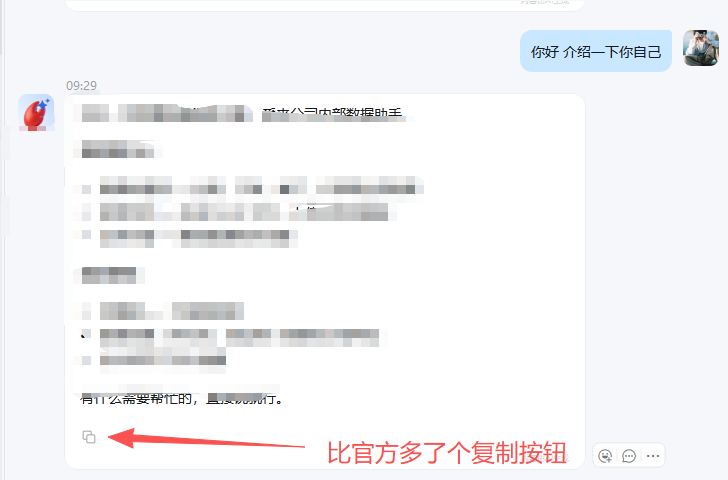

<div align="center">
  
  <h1>dingtalk-openclaw-connector（社区维护版）</h1>
  <p>基于官方 <strong>v0.8.20</strong> 的社区维护版本，由社区持续跟进修复官方无暇处理的 Bug。<br/>
  功能与官方完全一致，拥有最快的修复速度，及时合并官方pr和个人发现的bug和社区急需的 Bug。</p>

  <p>
    <a href="https://www.npmjs.com/package/@dingtalk-real-ai/dingtalk-connector"></a>
    <a href="https://www.npmjs.com/package/@dingtalk-real-ai/dingtalk-connector"></a>
    <a href="https://github.com/jeikl/dingtalk-openclaw-connector-fix-Community/blob/main/LICENSE"></a>
  </p>

  <p>
    <a href="README.en.md">🇺🇸 English</a> •
    <a href="CHANGELOG.md">更新日志</a> •
    <a href="https://openclaw.ai/">OpenClaw 官网</a>
  </p>
</div>

---

## 🔧 最近更新

| 日期 | 标识 | 更新内容 |
|------|------|---------|
| 2026-10-31 | 📝 | **可编辑钉钉规则（agent-guidance）**：可选增强，安装或升级 connector 不自动启用；显式运行 `guidance setup` 提供规则、配置官方插件并 reload。已有文件默认跳过，支持 `--overwrite-rules` 替换模板；详见 [配置与维护](docs/agent-guidance.md) |
| 2026-10-14 | 📝 | **修复偶发无法换行**：钉钉卡片上有时换行不生效，多行会挤成一行 |
| 2026-10-14 | 🖼️ | **OpenClaw 出站图片**：正文 `` 进卡；独立 `MEDIA:` / `mediaUrl` 等卡片/正文发出后再 `sendMedia`；Agent 写法见 `dingtalk-channel-rules` |
| 2026-10-13 | 📣 | **群聊回复 @ 提问者（at-sender）**：群里 @ 机器人时，回复会 @ 发送人并通知；详见 [at-sender](#-群聊回复--提问者at-sender) |
| 2026-10-12 | 🧭 | **AI Card 执行过程可视化（card-exec-preview）**：opt-in 投影工具/计划/推理；详见 [执行过程可视化](#-ai-card-执行过程可视化card-exec-preview) |
| 2026-10-12 | 👍 | **AI Card 赞踩反馈（card-feedback）**：自定义模板按钮回调写入会话；详见 [赞踩反馈](#-ai-card-赞踩反馈card-feedback) |
| 2026-10-09 | 👋 | **企业事件订阅监听（org-events）**：在现有 Stream 上按配置监听企业事件，默认关闭。已提供「企业增加员工」新人指引。详见 [org-events](#企业事件订阅监听org-events) |
| 2026-06-09 | 📁 | **专题 issue 统一至 `memory/*-issue.md`**：`dingtalk-issue` / `musa-stack-issue` / `openclaw-issue`；Agent 禁止堆叠根 MEMORY |
| 2026-06-09 | 🧠 | **memory-scope 架构优化（fix13–15）**：双层 MEMORY 注入、规则 sync、prompt 仅路径、移除 tool-guard；详见 [memory-scope](#-按用户群聊隔离长期记忆memory-scope) |
| 2026-06-08 | 🛡️ | **OpenClaw edit 参数校验 workaround（`edit-empty-oldtext`）**：dist patch 修复空 `oldText` 误报；见 `openclaw-patch/2026.5.7/edit-empty-oldtext/` |
| 2026-06-03 | 🔒 | **按用户/群聊隔离长期记忆（memory-scope）Phase 1**：钉钉多人共用一个 bot 时的 scope 目录与 session 解析；详见下方 [memory-scope](#-按用户群聊隔离长期记忆memory-scope) |
| 2026-05-14 | ✨ | Markdown 图片发送支持直链和本地路径，无需下载到本地，请参考下列提示词|
| 2026-05-11 | 🔧 | Agent 多轮循环完成后，中间过程消息重复发送到钉钉对话，造成刷屏和 AI Card 倒放重渲染 |
| 2026-05-11 | 🐛 | OpenClaw 4.29+ 版本导致钉钉插件失效，群聊 @Agent 回复显示"✅ 任务执行完成（无文本输出）" |
| 2026-05-08 | 🌐 | 未注册的 Pong 监听器导致的 WebSocket 幻影重连，来源于 [PR #566](https://github.com/DingTalk-Real-AI/dingtalk-openclaw-connector/pull/566)（[Majorshi](https://github.com/Majorshi) 提交） |

完整更新日志：[FIXES.md](FIXES.md)（[🇺🇸 English](FIXES.en.md)）

---

## ✨ 增强功能

- 📝 **可编辑 DWS 场景规则（可选）**：安装或升级 connector 不自动启用；管理员显式运行 `guidance setup` 后提供规则、配置官方 `agent-guidance` 并 reload。已有文件默认跳过，`--overwrite-rules` 显式替换模板。目录新增 Markdown 无须改代码。见 [配置与维护](docs/agent-guidance.md)。

- 🔧 OpenClaw 出站图片经 connector 发出。Agent 写法在 bundled skill `dingtalk-channel-rules`（正文 `` 进卡；独立 `MEDIA:` 走 `sendMedia`；无前缀裸路径不转图）。

- 🎨 支持自定义 AI Card 模板，可使用本人预制的卡片（含内容复制按钮），不填则使用官方默认卡片。
- 📣 **群聊回复 @ 提问者（at-sender）**：群聊被动回复时 @ 发送人并通知（见下方专节）。
- 👍 **赞踩反馈（card-feedback）**：卡片按钮回调写回本轮助手消息（见下方专节）。
- 🧭 **执行过程可视化（card-exec-preview）**：可选投影工具/计划/推理到过程区（见下方专节）。

**单机器人：**

```json
"channels": {
  "dingtalk-connector": {
    "enabled": true,
    "clientId": "你的clientId",
    "clientSecret": "你的clientSecret",
    "cardTemplateId": "616459cb-a388-4001-9b65-fbb2665ff94c.schema",
    "cardContentVar": "content",
    "cardProcessVar": "process",
    "cardReasoningVar": "reasoning",
    "cardLikeActionId": "ai_res_like",
    "cardDislikeActionId": "ai_res_dislike",
    "cardFeedbackStatusKey": "like"
  }
}
```

**多机器人（多 Agent）：** 每个账号可绑定不同机器人

```json
"channels": {
  "dingtalk-connector": {
    "enabled": true,
    "accounts": {
      "main-bot": {
        "enabled": true,
        "name": "工作流机器人",
        "clientId": "你的clientId",
        "clientSecret": "你的clientSecret",
        "cardTemplateId": "f9b75aac-713c-40e8-a17f-e236d7b5422b.schema",
        "cardContentVar": "content"
      },
      "another-bot": {
        "enabled": true,
        "name": "另一个机器人",
        "clientId": "另一个clientId",
        "clientSecret": "另一个clientSecret",
        "cardTemplateId": "f9b75aac-713c-40e8-a17f-e236d7b5422b.schema",
        "cardContentVar": "content"
      }
    }
  }
}
```

| 参数 | 说明 |
|------|------|
| `clientId` / `clientSecret` | 单机器人模式直接填在顶层 |
| `accounts` | 多机器人模式，key 为账号标识名（可任意命名） |
| `accounts.*.enabled` | 是否启用该账号 |
| `accounts.*.name` | 账号显示名称（仅用于标识） |
| `accounts.*.clientId` | 钉钉应用 ClientId |
| `accounts.*.clientSecret` | 钉钉应用 ClientSecret |
| `cardTemplateId` | AI Card 模板 ID，不填则使用官方默认模板 |
| `cardContentVar` | 最终回复内容变量名，不填默认 `msgContent`（**唯一**流式正文变量） |
| `cardProcessVar` | 可选：执行过程摘要变量；与 `cardReasoningVar` 任一非空即启用过程可视化 |
| `cardReasoningVar` | 可选：推理过程变量；仅在上游 `onReasoningStream` 有数据时写入 |
| `cardToolVar` | 工具输出变量；未启用过程可视化时可写入；启用 `cardProcessVar` 后不再 dump 原始输出 |
| `cardLikeActionId` | 赞按钮 `actionId`，默认 `ai_res_like` |
| `cardDislikeActionId` | 踩按钮 `actionId`，默认 `ai_res_dislike` |
| `cardFeedbackStatusKey` | 完成态写入的赞踩状态字段，默认 `like`（`0`/`1`/`-1`） |

> 卡片模板需在[钉钉开放平台](https://open.dingtalk.com/)创建，并添加对应的变量字段。正文只走 `cardContentVar`；过程/推理只能经独立变量更新，**不会**回落到流式正文键。

**效果预览：**



### 📣 群聊回复 @ 提问者（at-sender）

群里有人 @ 机器人时，回复会 @ 那个人（蓝色 @ + 钉钉通知）。用入站已有的 `senderStaffId` / `senderNick`，接到原有群聊回复出口，无新配置项。

| 项 | 说明 |
|------|------|
| 开关 | 默认开启；单聊不 @ |
| AI Card | 投放 `imGroupOpenDeliverModel.atUserIds`（通知）；创建时 `cardAtUserIds` + 正文 `@昵称`（卡片内蓝 @）。排队 ACK 与正式回复是同一张卡 |
| 降级 | `sessionWebhook` 的 text/markdown 同样带 `at.atUserIds`，正文附 `@userid` |
| 前提 | 机器人已发布上线（入站才有 `senderStaffId`）；不用加密 `senderId` 去 @ |

### 👍 AI Card 赞踩反馈（card-feedback）

在现有 Stream 上监听卡片回调（`/v1.0/card/instances/callback`），把赞/踩写回**本轮助手消息**（按 `cardInstanceId` 绑定），供旁路后台或会话侧消费。

OpenClaw 新版已把热会话迁到 per-agent SQLite（`agents/<id>/agent/openclaw-agent.sqlite`），`sessions/*.jsonl` 仅作迁移遗物。本插件会：**优先 patch SQLite/`sessions.json` 对应助手行**；并始终追加 `~/.openclaw/dingtalk-card-feedback.jsonl` 旁路记录，避免 DB-first 环境只亮 UI、不落盘。

| 项 | 说明 |
|------|------|
| 开关 | 使用带赞踩按钮的自定义模板即可；完成态会写入 `cardFeedbackStatusKey=0` 以便灰钮显示 |
| 模板 | 按钮 `actionId` 需与 `cardLikeActionId` / `cardDislikeActionId` 一致；显示条件绑 `like`（或你配置的 status key） |
| 绑定 | 出卡时登记 `outTrackId → session`；终态再给助手行盖上 `cardInstanceId` |
| 落盘 | SQLite transcript（及遗留 JSONL）+ `dingtalk-card-feedback.jsonl` sidecar |
| 非侵入 | 不另开 Stream；未配自定义赞踩模板时行为与原先一致 |

### 🧭 AI Card 执行过程可视化（card-exec-preview）

可选能力：把工具开始、计划更新、命令与（可选）推理摘要投影到卡片过程区（状态用正文，命令用代码块），正文仍只流式写入 `cardContentVar`。

推荐模板 `616459cb-a388-4001-9b65-fbb2665ff94c.schema`（含过程/推理变量，执行中过程区带滚动容器，并已带 [赞踩](#-ai-card-赞踩反馈card-feedback) 按钮）。

| 项 | 说明 |
|------|------|
| 开关 | 配置非空 `cardProcessVar` 和/或 `cardReasoningVar` 即启用，且依赖流式 AI Card（`streaming` 未关）；都不配则零开销 |
| 写入 | 过程/推理走 `PUT /card/instances`（非 streaming）；与正文共用 per-card 写链，避免 `flowStatus` 竞态 |
| 闸门 | 正文开始前进入 `contentStarted`，冲刷已缓冲的过程/推理；之后不再发 `flowStatus=4` |
| 抑制 | 启用过程变量后抑制默认工具进度刷屏；过程区用 Markdown：状态用正文，命令一律进代码块；不把原始输出 dump 进 `cardToolVar` |

### 企业事件订阅监听（org-events）

在现有机器人 Stream 上监听企业事件，不另开连接，也不写 `openclaw.json`。

已提供的事件：

| 事件 | 行为 |
|------|------|
| `user_add_org`（企业增加员工） | 开关打开时，按新人指引给该员工发一条单聊。不走 Agent，不创建 session 或 memory |

`user_add_org` 的补充说明：

| 项 | 说明 |
|------|------|
| 开关 | `~/.openclaw/dingtalk-org-events/onboarding/settings.json` 的 `enabled`。每次收到事件再读，不用重启 gateway。文件不存在时先写成 `false` |
| 文案 | 同目录的 `new-employee.md` 和 `city-contacts.png`。目录里还没有时，从安装包 `templates/` 拷一份。之后的发布不覆盖这里 |
| 职能表 | 第三章用旁边的 `city-contacts.png`。上传后把 mediaId 写进同一条 Markdown 的 ``，整段用互动卡片发出 |
| 姓名 | 官方报文只有 `userId`。发送前用 `user/get` 取通讯录 `name` 填入「嗨，{{name}}，」。需要应用权限 `qyapi_get_member`；查不到则收成「嗨，欢迎新同学…」 |
| 幂等 | `~/.openclaw/dingtalk-org-events/<accountId>.json`，同一事件不重复发 |

```json
{ "enabled": true }
```

### 🔒 按用户/群聊隔离长期记忆（memory-scope）

多人共用一个钉钉机器人时，OpenClaw 默认会把 workspace 根目录 `MEMORY.md` 注入每一个 session，且用户专属规则容易写进公共层，导致跨用户泄漏或指令冲突。

社区版内置 **`memory-scope` 模块**（`src/memory-scope/`，与 message-handler 解耦），在钉钉 session 上实现**双层记忆 + 规则 sync**（2026-06 优化）。DWS 认证与[官方 connector](https://github.com/DingTalk-Real-AI/dingtalk-openclaw-connector) 一致由 **Agent exec** `auth status` / `auth login`；本部署差异仅为 per-sender（`--sender-id` + `~/.dws/users/<id>/`）。connector 只注入 `DWS_AUTH_IDENTITY`，见 **dws skill** `references/dws-auth-workflow.md`（auth 文档归 dws 仓库，本仓库仅引用）。

#### 双层记忆模型

| 层级 | 路径 | 内容 |
|------|------|------|
| **公共层** | `workspace/MEMORY.md` | 仅含 memory-scope 架构/纪律规则（标记段）；**Agent 不得堆叠内容** |
| **Scope 层** | `memory/users/{id}/MEMORY.md` 或 `memory/groups/{cid}/MEMORY.md` | 当前私聊/群聊专属偏好与规则 |
| **专题 issue** | `memory/dingtalk-issue.md` 等 | 钉钉 / MUSA / OpenClaw 踩坑（Agent 写入，见下方命名） |

OpenClaw bootstrap 以**完整文件路径**区分两份 `MEMORY.md`，不会混淆。

#### 工作机制

| 机制 | 作用 |
|------|------|
| `agent:bootstrap` | **同时**注入根 `MEMORY.md` 与当前 scope 的 `MEMORY.md`；scope 文件缺失时自动创建 |
| 插件 `register` 时 sync | 每次 gateway 启动 replace `MEMORY.md` / `AGENTS.md` 标记段（段外保留）；`AGENTS.md` 首次无标记时先 migrate 旧 OpenClaw 冲突段 |
| `before_prompt_build` | 仅注入 **会话记忆路径**（3 行），不在 prompt 重复规则 |

**约束方式：** 本阶段**不使用** `before_tool_call` / tool-guard 做路径 block 或 rewrite，靠 bootstrap + `MEMORY.md` 规则 + 极简路径 prompt 约束模型行为。

#### 目录约定

| 场景 | 路径 |
|------|------|
| 私聊 | `memory/users/{senderId}/MEMORY.md`、`memory/users/{senderId}/YYYY-MM-DD.md` |
| 群聊 | `memory/groups/{conversationId}/MEMORY.md`、… |
| 群内按人隔离（`groupSessionScope: group_sender`） | `memory/groups/{conversationId}/users/{senderId}/...` |

#### 配置（默认开启）

```json
"channels": {
  "dingtalk-connector": {
    "memoryScope": {
      "enabled": true,
      "syncRootMemoryRules": true,
      "syncAgentsMemoryRules": true
    }
  }
}
```

| 选项 | 说明 |
|------|------|
| `enabled: false` | 关闭 memory-scope，恢复 OpenClaw 默认（全局 `MEMORY.md`） |
| `syncRootMemoryRules: false` | 不自动写入/更新 `MEMORY.md` 标记段，规则完全手动维护 |
| `syncAgentsMemoryRules: false` | 不自动 sync `AGENTS.md` memory 标记段 |

#### 规则维护

- 共享片段：`src/memory-scope/memory-rules-shared.ts`；模板：`root-memory-rules.ts`（纪律真源）、`agents-memory-rules.ts`（工作流 + 指向 MEMORY）
- `MEMORY.md` / `AGENTS.md` 标记段：**每次 gateway 启动** replace 标记段内内容（段外用户内容保留）；`AGENTS.md` 首次无标记时先 migrate 旧 OpenClaw 冲突段
- **Agent 禁止** write/edit 根 `MEMORY.md`；按主题写入 `memory/` 下专题 issue 文件：
  - 钉钉/dws/connector → `memory/dingtalk-issue.md`
  - MUSA 软件栈 → `memory/musa-stack-issue.md`
  - OpenClaw/gateway/插件 → `memory/openclaw-issue.md`
  - 用户偏好/「记住这个」→ 当前 scope

#### memory_search（Phase 1）

- `memory_search` / `memory_get` 仍索引整个 workspace，**不做** corpus 硬拦截
- 跨 scope 检索纪律写在 `MEMORY.md` 标记段，由模型遵守

#### Gateway 启动日志确认

```
[dingtalk-connector][memory-scope] synced root MEMORY.md rules section
[dingtalk-connector][memory-scope] synced AGENTS.md memory marked sections
[dingtalk-connector][memory-scope] registered (enabled=true, syncRootMemoryRules=true, syncAgentsMemoryRules=true)
```

实现细节与 Agent 话术见 bundled skill：`skills/dingtalk-channel-rules/SKILL.md`。

---

## 为什么 Fork？

由于钉钉官方连接器那拉稀的仓库更新与 Bug 修复速度，所以 fork 了此仓库。

本版本在官方代码基础上由社区进行 Bug 修复和维护。**BUG 采用 Claude Code 官方模型修复，保证最大修复效果。**

欢迎民间大神提 PR，共建钉钉连接器生态！

---

## 与官方版本的差异

| 项目 | 说明 |
|------|------|
| 基础版本 | 官方 v0.8.20，功能完全一致 |
| 修复内容 | 官方一直不修的 Bug（见上方最近修复） |
| 可编辑钉钉规则 | 可选增强：显式运行 `guidance setup` 提供外部 Markdown、配置官方 agent-guidance 并 reload；安装或升级不自动启用，日常编辑无需重装。见 [配置与维护](docs/agent-guidance.md) |
| 企业事件订阅监听 | 现有 Stream 上监听企业事件。新人指引进 `~/.openclaw/dingtalk-org-events/onboarding/settings.json`，默认关闭 |
| 已接入事件：企业增加员工 | `user_add_org`。开关打开后给新员工发 Markdown 单聊 |
| memory-scope | 双层记忆 + `MEMORY.md` 规则 sync |
| OpenClaw dist patch | `openclaw-patch/` |
| 社区 dws OAuth | 补登录链 |
| 维护方式 | 社区维护，持续跟进官方更新 |

---

## 安装与要求

开始之前，请确保：

- **OpenClaw**：已安装并正常运行。详情请访问 [OpenClaw 官网](https://openclaw.ai/)
- **版本要求**：OpenClaw ≥ **2026.4.9**，通过 `openclaw -v` 查看
- **dws CLI 与 dws skill**（钉钉业务能力必装）：connector **不再内置** `dws-cli` skill；**社区版配套** [WangKangAandy/dingtalk-workspace-cli](https://github.com/WangKangAandy/dingtalk-workspace-cli)（含 per-sender OAuth）。在 connector 目录执行 `npm install` 时会 **自动 clone/更新 dws fork、安装 skill 到 `~/.openclaw/skills/dws`、编译 CLI 到 `~/.local/bin/dws`**（需 git；编译 CLI 需 Go）

> 如低于此版本，执行 `npm install -g openclaw` 升级。

### dws 自动安装（推荐）

```bash
# 安装 connector 后在其目录执行（openclaw plugins install -l 也会触发 postinstall）
cd ~/.openclaw/extensions/dingtalk-connector   # 或你的 clone 路径
npm install
dws --version   # 确认 CLI 在 PATH（~/.local/bin）
```

环境变量（可选）：

| 变量 | 说明 |
|------|------|
| `DWS_SKIP_AUTO_INSTALL=1` | 跳过自动安装 |
| `DWS_COMMUNITY_REF=main` | 指定 git 分支/tag（默认 `main`） |

### 手动安装（网络受限或跳过 postinstall 时）

```bash
git clone https://github.com/WangKangAandy/dingtalk-workspace-cli.git ~/.openclaw/vendor/dingtalk-workspace-cli
cd ~/.openclaw/vendor/dingtalk-workspace-cli
go build -o ~/.local/bin/dws ./cmd
node /path/to/dingtalk-connector/scripts/install-community-dws.js
```

**勿用** `npm i -g dingtalk-workspace-cli`（官方 open-dingtalk 包，与社区 connector 不匹配）。

---

## 卸载官方插件（避免冲突）

安装本版本前，先移除官方已安装的插件：

```bash


# 卸载官方版本
openclaw plugins uninstall dingtalk-connector

```

---

## 手动构建与部署、或者直接下载release构建产物直接进行安装

本版本需要手动编译安装（社区修复版，不在 npm 发布）：

```bash
# 1. 克隆仓库
git clone https://ghfast.top/https://github.com/jeikl/dingtalk-openclaw-connector-fix-Community.git
cd dingtalk-openclaw-connector-fix-Community

# 2. 安装依赖 & 构建 & 打包

# npm
npm install
npm run build
npm pack

# 或者 pnpm
pnpm install
pnpm run build
pnpm pack

# 3. 安装到 OpenClaw 并重启（release或当前目录构建产物）
openclaw plugins install ./dingtalk-real-ai-dingtalk-connector-0.8.20-fix6.tgz
openclaw gateway restart
```

---

## 使用指南

[OpenClaw 钉钉官方插件使用指南](https://alidocs.dingtalk.com/i/nodes/2Amq4vjg89GEno0zfPqoPGqdV3kdP0wQ?utm_scene=team_space)

---

## 进阶文档

- [手动配置指南](docs/DINGTALK_MANUAL_SETUP.md) — 手动填写凭证配置
- [钉钉 DEAP Agent 集成](docs/DEAP_AGENT_GUIDE.md) — 本地设备操作能力
- [多 Agent 路由配置](docs/MULTI_AGENT_SETUP.md) — 多机器人绑定不同 Agent
- [常见问题](docs/TROUBLESHOOTING.md) — 安装与使用问题排查
- [官方 README（中文）](README_DINGTALK_OFFICIAL.md)
- [Official README（English）](README_DINGTALK_OFFICIAL_en.md)

---

## 贡献

欢迎社区贡献！Bug 修复或功能建议，请提交 [Issue](https://github.com/jeikl/dingtalk-openclaw-connector-fix-Community/issues) 或 Pull Request。

---

## 许可证

本项目基于 [MIT](LICENSE) 许可证。

---

## 支持

- **问题反馈**：[GitHub Issues](https://github.com/jeikl/dingtalk-openclaw-connector-fix-Community/issues)
- **更新日志**：[CHANGELOG.md](CHANGELOG.md)
