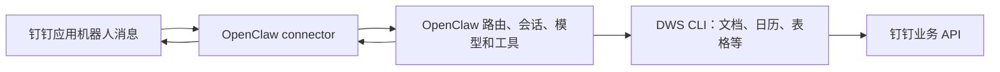
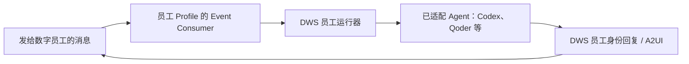

# DWS channel 能否替代 OpenClaw connector：官方源码与发布版核验

调研日期：2026-11-07，Asia/Shanghai。对象为 `DingTalk-Real-AI/dingtalk-workspace-cli` 与 `DingTalk-Real-AI/dingtalk-openclaw-connector`。本文是维护者资料，不部署到 live workspace。

本文保留实施前的接入架构核验。适配后的实现与验证边界见 [能力适配记录](channel-capability-adaptation.md)；最终交付时再次查询两个官方 main，提交仍与本文固定版本一致。

## 1. 结论

**不能依据“两个命令都接受 openclaw channel”来替换现有 connector；这句话的前提就不成立。**

1. `dws dingtalk-tag connect --channel openclaw`：官方稳定版 **v1.0.67 实际拒绝此参数**。源码只允许数字员工已适配的 Agent，明确排除 OpenClaw/Hermes。
2. `dws dev connect --channel openclaw`：支持这个渠道名称，但它选择的是 **`openclaw-connector` 外部接入方案**，不是 DWS 内置的 OpenClaw 消息转发器。当前默认实际执行 `openclaw gateway restart`，仍需要先完成 connector 安装、配置和机器人接入。
3. 数字员工使用**独立员工 Profile**收消息和回复。主管身份用于管理、换票和绑定，不能概括成“直接以你个人身份收发你的个人消息”。
4. 官方 connector 并不只有简单 IM 桥接：已包含宿主路由与会话、队列/中断、流式 AI 卡片、工具状态、原生问题表单等；安装器还主动配套 DWS。当前 OpenClaw 方案应理解为两者协作。
5. 检索到的官方仓库、发布记录及相关 issue/PR 中，**未找到“DWS 已替代 connector”或 connector 的弃用公告**。这不是对未公开路线图的判断。

建议：**当前小摩继续使用 connector + 官方 DWS，不因这两段转述卸载 connector。** 如果想改为“数字员工 + Codex/Qoder 等”，应作为另一条产品架构做隔离试点，不能当作同一 OpenClaw 接入方式的参数替换。

## 2. 版本与证据范围

| 对象 | 本次核验版本 | 固定提交 / 状态 |
|---|---|---|
| DWS 最新稳定发布 | v1.0.67，2026-11-04 | `63a7c4906c7dee10750011ea309b9eb78abb7eb0`；npm latest 一致 |
| DWS main | 2026-11-06 的 main | `c631e4fbf701dcac0b397e674068c3b65a8d2bd2`；npm beta 为 1.0.68-beta.1 |
| 官方 connector main / 最新发布 | v0.8.27，2026-10-20 | `88df00ee594072e9941ef3f71da90a37f3291ad3`；npm latest 一致 |

DWS 的 `deap_agent_adapter.go`、`deap_agent_channel.go`、`devapp_connect.go`、`connect_stream.go`、`deap_agent_runtime.go`，以及数字员工 Skill 和接入 reference，共 **7 个关键文件在 v1.0.67 与本次 main 内容完全相同**。因此下面的接入结论不是只存在于某个未发布分支。

发布来源：[DWS v1.0.67](https://github.com/DingTalk-Real-AI/dingtalk-workspace-cli/releases/tag/v1.0.67)、[connector v0.8.27](https://github.com/DingTalk-Real-AI/dingtalk-openclaw-connector/releases/tag/v0.8.27)。

验证分级：

- **已执行**：官方稳定版 Windows amd64 二进制校验和验证、版本查询、两条命令的隔离 dry-run；GitHub API 发布/issue/PR 检索；固定 SHA 源码阅读。
- **已查阅但未重跑**：官方仓库的单元测试、发布验证及真实消息验收记录。
- **未执行**：真实数字员工创建/绑定、机器人接入、钉钉消息发送、模型运行、生产迁移与压力测试。没有升级本机原有 DWS，没有操作对端服务。

## 3. 对转述逐项核验

| 转述 | 核验结论 | 原因 |
|---|---|---|
| 数字员工原生支持 `--channel openclaw` | **不成立** | 发布版返回 validation / exit 3；允许值中没有 openclaw |
| 企业机器人原生支持 OpenClaw，因而不需要 connector | **前半句混淆了支持方式，后半句不成立** | 能识别渠道名称，但计划和实现都委托官方 connector / OpenClaw gateway |
| 数字员工以你个人身份收发消息 | **不准确** | 管理操作使用主管身份；运行消息与回复使用员工自己的精确 Profile |
| 两条路径的区别只是 OAuth 与 appKey/appSecret | **不完整** | 还涉及数字员工与应用机器人的平台主体、事件订阅、绑定、授权、执行协议和会话所有权；两者也可能同时用到应用标识和 OAuth |
| DWS 支持 A2UI、工具状态、daemon、设备绑定 | **成立，但必须限定路径与 Adapter** | 数字员工链路实现这些能力，不代表每个 channel 都有完整同等能力；不能套到不支持的 OpenClaw Adapter 上 |
| 消息实时 Stream 推送，不是轮询 | **主要接收路径成立** | 机器人是 Stream 回调；数字员工是员工 Profile 下的 Event Consumer，经个人 Stream/WebSocket 传输。重连、状态检查或回执等待不应与消息接收混为一谈 |
| connector 更轻量、DWS 更完善 | **不能由现有证据直接推出** | 没有相同场景性能基准；OpenClaw 下 DWS 仍依赖 connector；能力应按具体路径比较 |
| connector 是否废弃只能问团队 | **路线图需团队确认，但当前实现可以判断** | 当前代码明确依赖 connector，且最近稳定发布仍在增加功能；未找到公开替代/弃用声明 |

原引用的 `deap_agent_channel.go#L345` 在本次 main / 稳定版中只是 `newDeapChannelCommand` 的 Cobra 命令组构造，定义数字员工 Channel 机器协议入口。它既不是支持列表，也没有声明 OpenClaw Adapter，不能用来证明上述替代关系。[固定源码](https://github.com/DingTalk-Real-AI/dingtalk-workspace-cli/blob/63a7c4906c7dee10750011ea309b9eb78abb7eb0/internal/helpers/deap_agent_channel.go#L344-L350)

## 4. 路径一：数字员工的真实实现

### 4.1 支持哪些 Agent

`digitalEmployeeChannels()` 取 `dsh` 加 `agentSpecs` 中的 Agent；没有把机器人专用的 `openclaw` / `hermes` 外部渠道加入集合。`resolveDigitalEmployeeChannel()` 无法匹配时给出“OpenClaw/Hermes 暂未适配”。命令声明将这个集合用作 `--channel` 的 enum，所以甚至在后续运行器启动前就被参数校验拒绝。

当前允许值为：

```text
auto, claudecode, codebuddy, codex, custom, dsh,
gemini, opencode, pi, qoder, qoderwork, workbuddy
```

来源：[Adapter 列表与校验](https://github.com/DingTalk-Real-AI/dingtalk-workspace-cli/blob/63a7c4906c7dee10750011ea309b9eb78abb7eb0/internal/helpers/deap_agent_adapter.go#L22-L60)、[不支持时的分支](https://github.com/DingTalk-Real-AI/dingtalk-workspace-cli/blob/63a7c4906c7dee10750011ea309b9eb78abb7eb0/internal/helpers/deap_agent_adapter.go#L121-L132)、[命令 enum](https://github.com/DingTalk-Real-AI/dingtalk-workspace-cli/blob/63a7c4906c7dee10750011ea309b9eb78abb7eb0/internal/helpers/deap_agent_channel.go#L85-L105)。

### 4.2 身份与消息链路

```text
主管 DWS 登录身份
    └─ 校验已有且已发布的 local_agent
       └─ 受管换票、在线核验员工身份
          └─ 保存独立的员工 corpId:userId Profile（不切换主管 Current）
             └─ 服务端设备绑定 + 本地 Adapter

发给数字员工的消息
    → 员工身份的 Event Consumer / Stream
    → DWS 员工运行器、任务账本和会话映射
    → 已适配 Agent（例如 Codex app-server）
    → 员工身份的 A2UI 更新或引用回复
```

运行器的 `employeeCommand()` 显式带 `--profile <员工Profile>`，并剔除父进程的 OAuth 应用/Token 覆盖项；消息消费和回复调用使用 `cfg.Binding.DWSProfile`。因此“使用 OAuth”与“使用主管个人身份”不是同义词。

来源：[Profile 与绑定构造](https://github.com/DingTalk-Real-AI/dingtalk-workspace-cli/blob/63a7c4906c7dee10750011ea309b9eb78abb7eb0/internal/helpers/deap_agent_channel.go#L217-L255)、[子命令身份固定](https://github.com/DingTalk-Real-AI/dingtalk-workspace-cli/blob/63a7c4906c7dee10750011ea309b9eb78abb7eb0/internal/helpers/deap_agent_runtime.go#L119-L137)、[Event Consumer 启动](https://github.com/DingTalk-Real-AI/dingtalk-workspace-cli/blob/63a7c4906c7dee10750011ea309b9eb78abb7eb0/internal/helpers/deap_agent_runtime.go#L555-L566)、[个人 Stream 实现](https://github.com/DingTalk-Real-AI/dingtalk-workspace-cli/blob/63a7c4906c7dee10750011ea309b9eb78abb7eb0/internal/event/source/personal.go)。

这也不等于用户 A、B 向同一员工发消息时，业务操作自动分别切换为 A、B 的个人权限。员工身份、主管身份、消息发起人、被访问资源的授权主体应分别确认。当前源码还有平台投递授权和本地白名单的不同分支，不能只依据旧的“默认仅主管”一句话推断所有已绑定员工的访问范围。

### 4.3 能力与边界

官方接入 reference 对 A2UI 做了按 Adapter 的区分：Codex 与 Qoder/Claude Code 等可输出公开正文及工具进度；Gemini API/custom 主要保留占位后更新最终答案，custom 的 stdout 协议没有工具事件；Pi 暂无公开工具进度，按其回退路径回复。DSH 则由外部宿主负责执行和回复，不能把本地 Agent 的 `--daemon --alwayson` 原样套到 DSH。

`--alwayson` 是后台 worker 的恢复策略，不等于机器休眠仍在线或已配置开机自启。官方也明确不承诺 exactly-once、断线不丢消息；任务执行结果或回复结果未知时需要核实，不能自动重放以掩盖不确定性。其底层 Stream 的协议 ACK 不等于端到端业务任务已处理一次且仅一次。

来源：[回复模式、各 Adapter 能力和恢复边界](https://github.com/DingTalk-Real-AI/dingtalk-workspace-cli/blob/63a7c4906c7dee10750011ea309b9eb78abb7eb0/skills/multi/dingtalk-tag/references/manage-and-connect.md)、[Skill 的 Adapter 与后台约束](https://github.com/DingTalk-Real-AI/dingtalk-workspace-cli/blob/63a7c4906c7dee10750011ea309b9eb78abb7eb0/skills/multi/dingtalk-tag/SKILL.md#L47-L48)。

文档存在更新粒度不一致：`docs/digital-employee-adapters.md` 的历史范围段落仍把“卡片”列为不在本次范围，而当前运行器、接入 reference 与 A2UI 实现已经支持卡片。本文因此按**当前实现 + 发布版行为**判断，不把每段历史设计说明都当成当前能力表。[A2UI 实现](https://github.com/DingTalk-Real-AI/dingtalk-workspace-cli/blob/63a7c4906c7dee10750011ea309b9eb78abb7eb0/internal/helpers/deap_agent_card.go)

## 5. 路径二：dev connect 的 openclaw 是委托接入

`connectChannels` 是“外部渠道 + 内置 Agent”的联合列表。OpenClaw/Hermes 是单独加入的外部渠道，不能因为它们与 Codex/Qoder 同列在 help 中，就推断运行方式相同。

### 5.1 预检明确要求 connector

`buildConnectPlan("openclaw", ...)` 返回：

```json
{
  "method": "openclaw-connector",
  "steps": [
    "按官方 connector 流程注册机器人",
    "启动 openclaw gateway，由连接器处理消息收发与卡片渲染"
  ]
}
```

这是上述返回的精简转述；完整原始 JSON 已保存到证据目录。来源：[OpenClaw plan](https://github.com/DingTalk-Real-AI/dingtalk-workspace-cli/blob/63a7c4906c7dee10750011ea309b9eb78abb7eb0/internal/helpers/devapp_connect.go#L127-L136)。

### 5.2 真正执行的分支

```text
dws dev connect --channel openclaw
    → 解析/取得应用机器人凭证
    → connectExternalCommand("openclaw")
    → 默认外部命令：openclaw gateway restart
    → 运行在 OpenClaw 内的 dingtalk-openclaw-connector 负责钉钉通信
```

`launchConnector()` 的外部命令分支早于 DWS 内置 Stream 分支。测试也明确断言 `openclaw` **不是** `isStreamBridgeChannel`。

来源：[外部命令与优先级](https://github.com/DingTalk-Real-AI/dingtalk-workspace-cli/blob/63a7c4906c7dee10750011ea309b9eb78abb7eb0/internal/helpers/devapp_connect.go#L224-L269)、[官方边界测试](https://github.com/DingTalk-Real-AI/dingtalk-workspace-cli/blob/63a7c4906c7dee10750011ea309b9eb78abb7eb0/internal/helpers/devapp_connect_test.go#L115-L177)。

这里还有容易被高估的自动化边界：注释提到了写 OpenClaw 配置，但该执行路径实际只把 `CID` / `SEC` / `DWS_AGENT_CHANNEL` 放入子进程环境后执行 gateway restart；本次没有在这条路径看到 connector 安装或 `openclaw.json` 的写入实现。因此不能保证仅指定 `unifiedAppId` 就会把一台未配置的 OpenClaw 接好。应以 connector 正式安装配置入口为准。

`DWS_CONNECT_CMD` 可覆盖外部命令，`custom` 可接自建 CLI，但这意味着自己实现另一套 Adapter。它不是现成的原生 OpenClaw 替代：身份、session key、取消、并发、媒体、卡片回调、重连和执行结果未知后的恢复，都需要另行设计与验证。

## 6. 两种真正成立的架构





在第一条链中移除 connector，会移除 OpenClaw 的钉钉 Channel；安装 DWS 的业务 CLI 不会补回这个 Channel。在第二条链中无需 OpenClaw connector，但运行时已经换为另一种受支持的 Agent，而不是保留原 OpenClaw 的等价迁移。

官方 connector 安装器默认会安装 DWS，并提供 `--skip-dws`；`getDwsSpawnEnv()` 也准备了 DWS 调用环境。这是两者协作的直接代码证据。[安装器](https://github.com/DingTalk-Real-AI/dingtalk-openclaw-connector/blob/88df00ee594072e9941ef3f71da90a37f3291ad3/bin/dingtalk-connector.js#L399-L472)、[安装入口](https://github.com/DingTalk-Real-AI/dingtalk-openclaw-connector/blob/88df00ee594072e9941ef3f71da90a37f3291ad3/bin/dingtalk-connector.js#L610-L646)、[DWS 调用环境](https://github.com/DingTalk-Real-AI/dingtalk-openclaw-connector/blob/88df00ee594072e9941ef3f71da90a37f3291ad3/src/channel.ts#L45-L74)。

另需注意：connector 0.8.27 安装器的 npm DWS spec 仍固定为 `dingtalk-workspace-cli@1.0.30`，并非本次 latest 1.0.67；脚本存在已安装新版本的处理分支。这说明两个包有独立发布节奏，不能把“安装了最新 connector”理解为“同时得到最新 DWS”。

## 7. “完善度”应按需求拆开

| 需求 | 官方 OpenClaw connector 0.8.27 | DWS 1.0.67 数字员工 / 内置 Agent |
|---|---|---|
| 保留 OpenClaw 的模型、workspace、bindings、原生会话 | 直接走 Host 路由与派发 | 没有 OpenClaw Adapter |
| 钉钉单聊/群聊的消息接入 | 机器人 Stream + 策略处理 | 员工 Event Consumer；机器人 dev connect 内置渠道则走另一套 Stream |
| 流式正文、工具状态、图片卡片 | 有，v2 卡片需配置和模板权限 | 有，但能力依 Adapter 而异，不能覆盖到 OpenClaw |
| 原生提问表单 | `dingtalk_ask_user_question`，同会话新回合续聊 | A2UI 能力不能自动等同于该 OpenClaw 工具；部分 Adapter 有自己的审批/交互实现 |
| 多机器人 / 多 Agent 路由 | accounts + Host bindings；另有实验 @别名 | 多员工绑定和各 Agent 协议，不是相同的 Host 路由模型 |
| 停止 / 中断 / 队列 | 连接 OpenClaw Host 队列与 `/stop`，有 `/btw` | 由 DWS 与各 Agent Adapter 的协议管理；无 OpenClaw 等价实现 |
| 钉钉文档、表格、日历等业务操作 | 可通过 DWS / Skill 调用 | DWS 本身的业务能力；两条架构都可使用 |
| 员工生命周期、独立 Profile、设备绑定 | 不属于 connector 的核心职责 | 有 manage/connect/binding 生命周期 |
| 直接替代小摩现有企业定制 | 也不能直接覆盖定制 fork | 更不能默认继承定制 fork |

connector 的 v0.8.27 新增引用恢复、结构化卡片、工具状态、原生表单、实验多助手和 `/btw` / 停止，并修复旧 WebSocket 的迟到关闭事件。[版本说明](https://github.com/DingTalk-Real-AI/dingtalk-openclaw-connector/blob/88df00ee594072e9941ef3f71da90a37f3291ad3/docs/RELEASE_NOTES_V0.8.27.md)、[能力及配置边界](https://github.com/DingTalk-Real-AI/dingtalk-openclaw-connector/blob/88df00ee594072e9941ef3f71da90a37f3291ad3/docs/COMMUNITY_CAPABILITY_ALIGNMENT.md)。

它也有不能忽略的限制，不能反向得出“官方 connector 所有方面都完善”：

- 当前代码中 `dmPolicy="pairing"` 仍按 open 处理并记录警告，不能把 pairing 配置值当作已实施的访问控制。[源码](https://github.com/DingTalk-Real-AI/dingtalk-openclaw-connector/blob/88df00ee594072e9941ef3f71da90a37f3291ad3/src/core/message-handler.ts#L959-L968)
- Host 群会话按配置可能跨机器人共享；官方说明建议用不同 Agent 做隔离。v2 卡片需权限/模板，真实 token 元数据还依赖宿主 hook 授权。
- 存在音视频入站媒体元数据与宿主理解管线衔接的未关闭报告；这是 issue 提供的特定版本复现，本次未做实机复现。[issue #675](https://github.com/DingTalk-Real-AI/dingtalk-openclaw-connector/issues/675)
- 发布 PR 记录的全量测试仍有基线既有失败，不能将其包装为“全部测试绿灯”；新增能力说明也区分了自动化验证和真实钉钉客户端验收。[发布 PR #681](https://github.com/DingTalk-Real-AI/dingtalk-openclaw-connector/pull/681)

DWS 的消息可靠性也应依据具体验收：官方 `digital-employee-readiness-validation.md` 记录了特定 DSH 场景成功、来源对照和待定位问题，并明确不能把进程 running、IPC ready 或少数成功样本外推为全部 Adapter 的端到端验收。[验收记录](https://github.com/DingTalk-Real-AI/dingtalk-workspace-cli/blob/63a7c4906c7dee10750011ea309b9eb78abb7eb0/docs/digital-employee-readiness-validation.md)

## 8. 社区维护与“会不会统一”

两仓均未归档。DWS 11 月 4 日发布 1.0.67，main 11 月 6 日仍更新；connector 10 月 20 日发布 0.8.27，其中含实质消息能力和连接稳定性变更。版本号不能横向衡量成熟度，提交频率也不等于生产质量。

相关公开演进证据：

- DWS [PR #407](https://github.com/DingTalk-Real-AI/dingtalk-workspace-cli/pull/407) 的方案已经明确把 OpenClaw/Hermes 路由到各自官方 onboarding。该 PR 自身未合并；协作者关闭说明称能力收拢进 devapp，不能把其中旧 `dws connect` 命令直接当成现行用法。
- 数字员工能力由 DWS [PR #1391](https://github.com/DingTalk-Real-AI/dingtalk-workspace-cli/pull/1391) 于 9 月 22 日合入，强调员工独立身份、本地 Adapter 和设备绑定，没有据此实现 OpenClaw Adapter。
- connector [PR #673](https://github.com/DingTalk-Real-AI/dingtalk-openclaw-connector/pull/673)、[#678](https://github.com/DingTalk-Real-AI/dingtalk-openclaw-connector/pull/678)、[#681](https://github.com/DingTalk-Real-AI/dingtalk-openclaw-connector/pull/681) 在 10 月合入并发布，说明现行插件仍在演进。
- connector [issue #604](https://github.com/DingTalk-Real-AI/dingtalk-openclaw-connector/issues/604) 中维护协作者曾说明 DWS 身份能力与 connector 集成的职责划分。**这是 5 月的历史讨论**，其中“DWS 单登录态”的判断不能沿用到已有多 Profile 的 11 月版本；当前仍需要单独核验消息发送者到调用身份的绑定。

检索覆盖两个官方仓库中 openclaw / 数字员工 connect / dws / deprecated / 替代 等查询及其命中的关键条目；原始结果已保存。没有搜索命中只能表述为“本次未找到”，不能证明未来永不统一。产品团队仍需回答是否计划新增 OpenClaw 数字员工 Adapter、是否兼容 Host 会话与工具协议、是否有 connector 退役时间表及迁移验收标准。

## 9. 对当前小摩的具体影响与建议

本次只读检查本地部署仓 `6691588e7893e3f274e3958cafd6a2bde96c5c73` 与 connector 子模块 `7e2f0be8ccbc426f145174c349607baf79af4329`；没有据此推断生产实际运行 SHA。

本地仍有以下与 connector 入口耦合的能力：

| 本地能力 | 代码位置 | 移除 connector 后需要重做或证明的事项 |
|---|---|---|
| 按可信消息发送者注入官方 DWS `--profile` | `extensions/dingtalk-openclaw-connector/src/dws-exec-identity.ts` | 员工 Profile 不等于消息发送者 Profile；需要重新定义业务身份策略并验证隔离 |
| 用户/群记忆隔离 | `extensions/dingtalk-openclaw-connector/src/memory-scope/` | DWS 的员工/会话隔离不是相同的 OpenClaw bootstrap/memory hooks |
| 入职等组织事件与欢迎内容 | `extensions/dingtalk-openclaw-connector/src/org-events/` | 员工聊天接收不等于组织事件处理器，不能默认随迁移保留 |
| admin 会话列表和分析 | `apps/admin/src/sessions.ts`；本聊天的 PR #4 | 管理端筛选 `dingtalk-connector` 会话。换 Agent 后不能指望原 OpenClaw SQLite reader 显示其历史 |

针对现有“小摩 = OpenClaw + 企业定制 connector + 官方 DWS + admin”，建议维持消息接入层，继续让 DWS 跟随官方 npm 版本。不要因 DWS 多 channel 列表删除 connector，也不要将历史 DWS 子模块重新当作生产构建源。

如果目标是“减少自维护代码”，可分别评估：

1. **保留 OpenClaw**：跟进官方 connector 的宿主适配/消息核心，将 sender→profile、企业记忆和组织事件等必要扩展缩到清晰接口；这与采用官方 DWS 不冲突。
2. **改为数字员工托管 Agent**：选一个已支持的 Agent 和专用测试员工，独立测试身份、群权限、流式回复、工具调用、停止、重连、重启、重复消息、历史映射和 admin。确认接受 OpenClaw 特性与定制迁移成本后再决策。
3. **坚持数字员工 + OpenClaw**：先让官方确认 Adapter 计划，或自行开发正式桥接。使用 `custom` 包一条命令只是原型入口，不能作为完成迁移的证据。

本次不把“个人助手”与“组织服务”一刀切对应到某个 CLI 子命令。数字员工本身也有组织/发布可见范围；选型应从身份、入口、宿主和必需能力出发。

## 10. 可直接回复对方

> 我核对了官方 DWS v1.0.67 和当前 main，这里需要修正一下：`dingtalk-tag connect --channel openclaw` 当前不支持，发布版会直接报参数校验错误；`dev connect --channel openclaw` 虽然接受渠道名称，但预检明确返回 `openclaw-connector`，实际默认委托 OpenClaw gateway，仍依赖官方 connector。
>
> DWS 可以直接托管 Codex/Qoder 等已适配 Agent，数字员工的 A2UI、工具状态、设备绑定也确实有实现，但不能把这些能力等同于已支持 OpenClaw。数字员工运行时使用独立员工 Profile，也不是直接以主管个人身份接管个人聊天。
>
> 对现有 OpenClaw，更准确的关系是 connector 负责消息通道和宿主集成，DWS 负责钉钉业务操作；目前没有查到 connector 已被替代或宣布废弃的公开依据。若团队已有未公开的 OpenClaw 数字员工 Adapter，希望提供具体版本、实现或迁移说明再评估。

## 11. 可复核的离线命令验证

从官方 v1.0.67 Release 下载 Windows amd64 二进制，并对照同 Release 的 `checksums.txt` 校验 SHA-256。仅解压到临时目录，不覆盖 PATH 中原有 v1.0.66。设置独立 `DWS_CONFIG_DIR`，关闭 telemetry 和自动版本检查；没有读取日常账号凭据。

以下 `offline-research-placeholder` **只是本地 dry-run 的测试输入，不代表真实员工或应用 ID**。源码确认这两个测试在校验/预检处分流；不将它用于正式调用。

```text
dws --version
→ v1.0.67 / 63a7c4906c7dee10750011ea309b9eb78abb7eb0

dws dingtalk-tag connect --agent-uuid offline-research-placeholder \
    --channel openclaw --daemon --alwayson --dry-run --format json
→ exit 3，validation；--channel openclaw 不在允许值中

dws dev connect --unified-app-id offline-research-placeholder \
    --channel openclaw --dry-run --format json
→ exit 0；connect.method=openclaw-connector
→ completionState=LOCAL_DEBUG_ONLY；doesNotPublish=true
→ 凭证获取在 dry-run 中跳过；要求先完成官方 onboarding
```

第二项 exit 0 仅说明预检生成成功，不代表已建联、connector 已装好或机器人已发布。`cli.installed` 只检查 OpenClaw 可执行文件可发现，不检查插件与消息链路。

随代码提交的证据目录：[docs/evidence/dws-connector-channel-2026-11-07](./evidence/dws-connector-channel-2026-11-07/)，包括隔离命令回执 `stable-cli-probes.json`、`stable-main-comparison.json` 和版本记录。大量 issue/PR 检索快照保留在维护者本地；本文提供对应官方原始链接，不整批复制讨论原文。结论以本次核验日期及固定提交为界。
